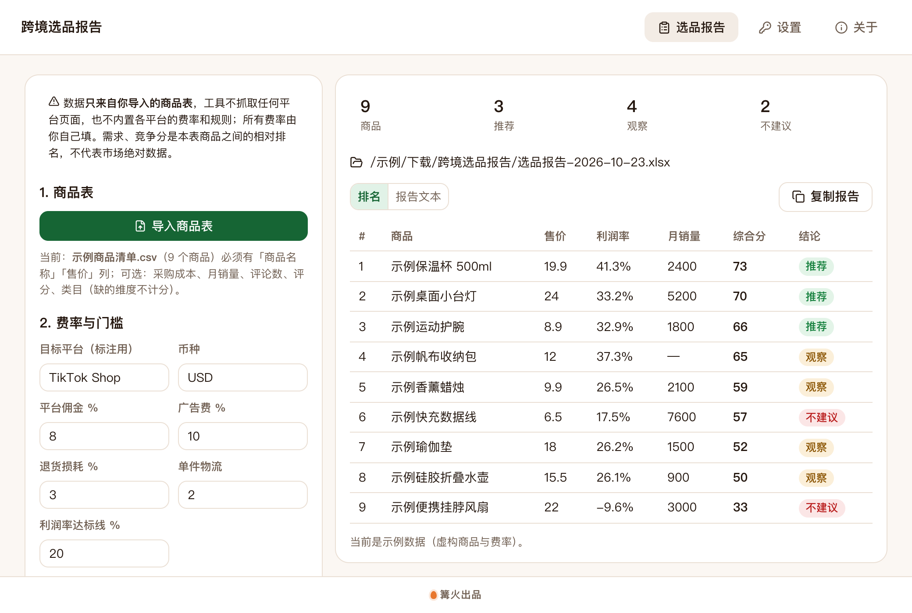

# 跨境选品报告

> 篝火出品 · 收录于篝火 App 应用区

TikTok / 亚马逊选品分析报告：导入商品表，按利润、需求、竞争、口碑打分排名，生成选品报告，可选用你自己配置的大模型写解读。

> **说明（风险等级：低）**：数据只来自你导入的表格（例如自己从选品工具、平台后台导出的 .xlsx / .csv），**工具不抓取任何平台页面，也不内置各平台的佣金、物流费率或类目规则**，这些都要你自己填；评分口径是本工具自定的，只用于排序参考，不是平台或市场的权威数据。上游 nexscope-ai/eCommerce-Skills 是给 AI 助手用的选品技能集合，本工具没有使用其内容。



## 下载

到 [Releases](https://github.com/campfire-code/crossborder-product-research/releases/latest) 下载对应安装包：

| 电脑 | 文件 |
|---|---|
| Windows 10 / 11 | `crossborder-product-research_版本号_windows-x64-setup.exe` |
| Mac（Apple 芯片） | `crossborder-product-research_版本号_mac-arm64.dmg` |
| Mac（Intel 芯片） | `crossborder-product-research_版本号_mac-x64.dmg` |

第一次打开：
- **Windows**：如果弹出「Windows 已保护你的电脑」，点「更多信息」→「仍要运行」。
- **Mac**：如果提示「无法验证开发者」，打开「系统设置 → 隐私与安全性」，在下方点「仍要打开」。

## 怎么用

1. 点「导入商品表」或把 .xlsx / .csv 拖进窗口。必须有「商品名称」「售价」两列（中英文表头关键词均可，如 Title / Price）；可选「采购成本」「月销量」「评论数」「评分」「类目」。缺哪项，对应维度按中性 50 分计入，且缺月销量的商品不会被评为「推荐」。
2. 填「费率与门槛」：平台佣金 %、广告费 %、退货损耗 %（都按售价的百分比扣）、单件物流（本币金额）、利润率达标线 %。**这些全部由你填写，工具不内置任何平台费率**；全为 0 时界面和报告都会提示利润被高估。
3. （可选）勾选「AI 解读」，并到「设置」页填自己的接口地址、密钥、模型名（兼容 OpenAI 接口格式；密钥只存在本机）。工具只把排名前 10 的商品数据发给你配置的接口，并要求模型不得编造表外数据。接口出错时数字报告照常生成，并写明未生成原因。
4. 点「生成选品报告」。右侧看排名和报告文本，可复制；文件保存在「下载」文件夹的「跨境选品报告」目录：`选品报告-日期.xlsx`（排名 + 参数说明两张表）和 `选品报告-日期.md`。

计算口径（本工具自定）：
- 单件利润 = 售价 − 采购成本 − 单件物流 − 售价 ×（佣金 + 广告 + 退货损耗）%；利润率 = 单件利润 ÷ 售价。没有采购成本则不算利润。
- 综合分（0–100）= 利润 35% + 需求 30% + 竞争 20% + 口碑 15%，缺数据的维度按中性 50 分计入。利润分：利润率 0% 为 0 分、40% 及以上满分；需求分：月销量在本表中的百分位；竞争分：评论数越少越高（本表百分位）；口碑分：评分 3 星 0 分、5 星满分。
- 结论：亏损或利润率低于达标线为「不建议」；缺成本为「观察」；其余综合分 ≥ 60 且有月销量为「推荐」，否则「观察」。
- 需求、竞争是本次导入商品之间的相对排名，商品太少（尤其只有 1 个）时意义有限。

## 验收用例

示例文件为虚构数据，在 `samples/商品清单-示例.csv`（7 个商品、1 行缺名称）：

1. 导入该文件。应提示「读到 7 个商品，跳过 1 行」。
2. 费率填：佣金 8、广告 10、退货损耗 3、单件物流 2，达标线 20，不勾选 AI 解读，点「生成选品报告」。应得到：商品 7；「示例保温杯 500ml」单件利润 8.22（= 19.9 − 5.5 − 2 − 19.9×21%）；「示例便携挂脖风扇」为「不建议」（利润率低于 20%）；「示例帆布收纳包」缺销量、评论数，仍参与排名（缺数据的维度按 50 分，结论最高为「观察」），备注里写明缺失。
3. 打开生成的 xlsx：「选品排名」7 行加表头（含各维度分和备注），「参数说明」一张；同目录有 md 报告，含「打分口径」一节。
4. 把费率全部改成 0 再生成：界面和报告里出现「利润被高估」提示。
5. 勾选 AI 解读但没在设置里填接口：报告照常生成，界面提示「还没有设置大模型……」，md 末尾「AI 解读」写明未生成。
6. 导入一个表头不含「售价」的表：报错并列出表头，不生成文件。

## 自己编译

需要 Node.js 22、pnpm、Rust。

```bash
pnpm install
pnpm test          # 单元测试
pnpm tauri dev     # 开发运行
pnpm tauri build   # 打包
```

界面框架在 `src/kit`（所有 campfire-code 工具共用），本工具的逻辑在 `src/tool`。

## 致谢

本工具的需求参考开源项目 [nexscope-ai/eCommerce-Skills](https://github.com/nexscope-ai/eCommerce-Skills)（MIT，面向 AI 助手的电商技能集合）。本工具未使用其内容。

## 归属

本工具由**篝火**出品，是篝火 App 应用区收录的开源工具之一，由篝火（GitHub 组织 [campfire-code](https://github.com/campfire-code)）维护与更新。全部工具的目录见 [toolkit-hub](https://github.com/campfire-code/toolkit-hub)。

## 许可证

MIT，版权方为篝火（campfire-code）。
